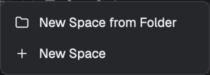

# Space Folder Picker

## Attribution and license

`mods/spaces-folder-picker/main.js` is modified from Herdr's `defaults/mods/spaces/main.js` at tag `v0.1.16` (commit `034f8b85f7e6bb71f8ff55cb4a80c548b2578c0f`): the sidebar header + now opens this package's folder-picker menu; the remaining Spaces behavior is retained. Herdr's upstream project is licensed under Apache-2.0. The complete upstream license text is included as `LICENSE`. No upstream `NOTICE` file was present in the provided source package.

In the Spaces sidebar, the + opens a two-item menu: choose a local folder before creating a space, or create a space the usual way. The folder choice uses the operating system's native picker.



## What you see

The existing Spaces sidebar keeps its machine groups, space rows, compact rail, selection, and Git details. Its 31 px header has a 26 px + button. Clicking it opens a 210 × 76 px popup with two 31 px rows: a folder icon and “New Space from Folder”, then a plus icon and “New Space”. Rows use the current theme's foreground, popover and selected colors, 12.8 px text, 14 px icons, 5 px outer padding and 7 px rounded hover backgrounds.

The sidebar retains the shipped Spaces mod's behavior for working, blocked, done and idle agents: in the compact rail the status glyph uses the corresponding theme color. This change adds no status display or animation.

## How it behaves

- Click the sidebar header + to open the menu. Hovering highlights a row.
- “New Space from Folder” opens the native folder picker. Selecting a folder creates a local space with that folder as its terminal's starting directory. Cancel closes the picker and menu without creating a space. A picker error displays a notification.
- “New Space” closes the menu and runs the original `space.new` command without arguments.
- Machine-specific + buttons, space selection, drag ordering, context menus and the rest of the Spaces sidebar keep the shipped behavior. Remote machine entries are unchanged; the native picker is local only.
- This mod adds no keyboard binding. Popup dismissal follows Herdr's standard popup behavior.

## Built from

Start with Herdr 0.1.16's shipped `spaces` mod, clone it as `spaces-folder-picker`, and retain its existing code, assets, machine grouping, Git metadata and status handling. Change only the header + handler to:

```js
openOverlay({ mod: "spaces-folder-menu", kind: "popup", width: 210, height: 76 })
```

Create `mods/spaces-folder-menu/main.js` as a `View` using `gpui-kit` and `gpui-base`, and set `mod.json` to `{"place":"none","overlay":{"width":210,"height":76}}`. Draw the rows with `v_flex`, `h_flex`, `div` and `svg`, using `theme()` and the shipped `mods/workspace-chrome/folder.svg` and `plus.svg` icons. Use `props().overlay` and `closeOverlay` for the popup.

For the folder row, keep the popup alive while awaiting `pickFolder({ prompt: "Choose a folder for the new space" })`. After it resolves, close the popup and, only when the result is not `null`, call `run("space.new", { folder, machine: "" })`. On rejection, close the popup and call `notify` with an error. For the ordinary row, close the popup and call `run("space.new")`.

The cloned Spaces mod uses the shipped `menu` and `machine-add` mods and `herdr` APIs including `spaces`, `machines`, `panes`, `hc`, `exec`, `watchFolder` and shared state. It runs `hc` for machine data and `git` in space directories for repository metadata, including on connected machines. The picker and menu make no network requests themselves.

### Connect the mod to a layout

Copy both folders under `mods/` to the recipient's Herdr home, taking care not to overwrite existing names. Use `herdr-app do layout.clone '{"name":"main","as":"main-folder-picker"}'` to clone and switch to a personal layout, choosing an unused name. In that clone, change the existing Spaces block's `content.mod` from `spaces` to `spaces-folder-picker`. Do not edit the shipped `main` layout. This package deliberately contains no `layouts/` folder and no `keys.json`.

## Watch out

- Closing the popup before the asynchronous picker resolves cancels the view's pending work: the folder can be selected but no space is created. Keep it open until the picker returns.
- The picker returns a local path or `null`; force `machine: ""` for a selected path so a focused remote machine does not receive a local path.
- The native picker and command may fail; do not create a space on cancellation. The shipped app reports command failures; this build reports picker rejection with `notify`.
- The copied sidebar is a snapshot of Herdr 0.1.16. A future Herdr update does not update the clone; compare it against the updated shipped `spaces` mod before adopting upstream fixes.
- The shipped menu accepts commands rather than arbitrary picker callbacks, so the popup is a separate mod. The layout must explicitly reference the cloned sidebar; copying mods alone does not replace the shipped sidebar.
- The screenshot shows the menu only. Layout appearance, agents and space names depend on the recipient's setup.

## Done when

1. `herdr-app check ~/.config/herdr-app/mods/spaces-folder-picker` and `herdr-app check ~/.config/herdr-app/mods/spaces-folder-menu` both pass.
2. The personal layout loads without errors and the Spaces header + displays both menu items.
3. Selecting an existing local folder creates a space shown in the sidebar, and its terminal's actual CWD equals the selected folder.
4. Cancelling the picker creates no space; the original “New Space” option still creates a space as before.
5. Existing spaces, tabs and agents remain present, and machine-specific creation still targets its selected machine.
